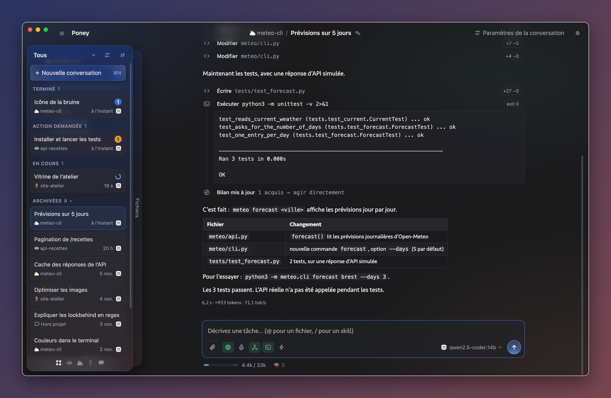
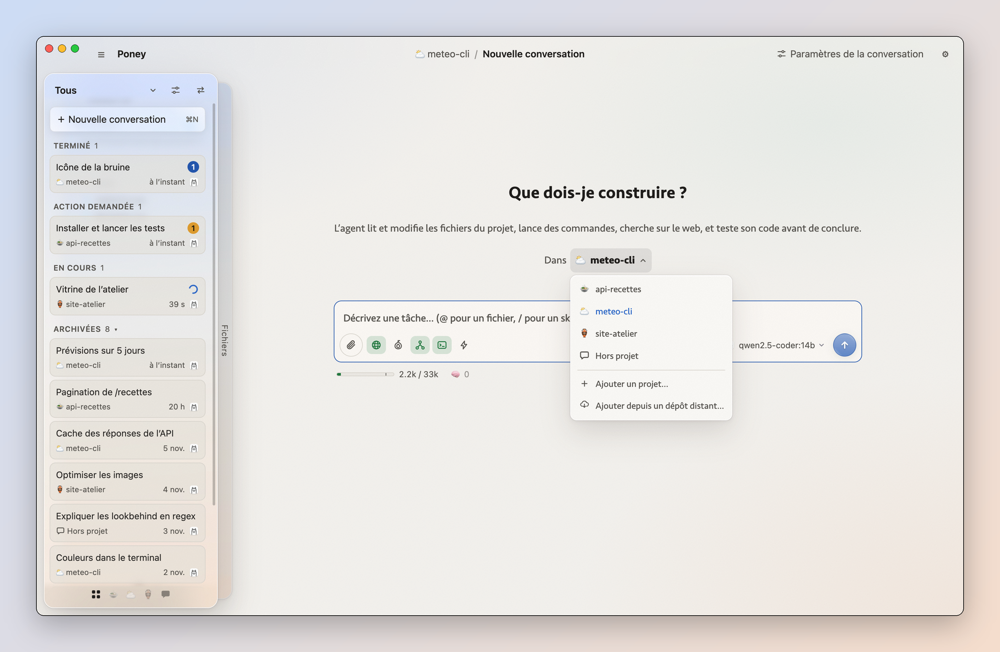
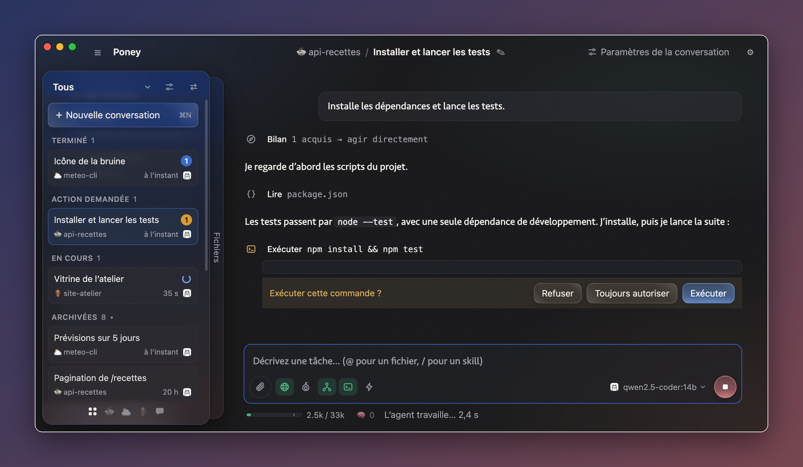
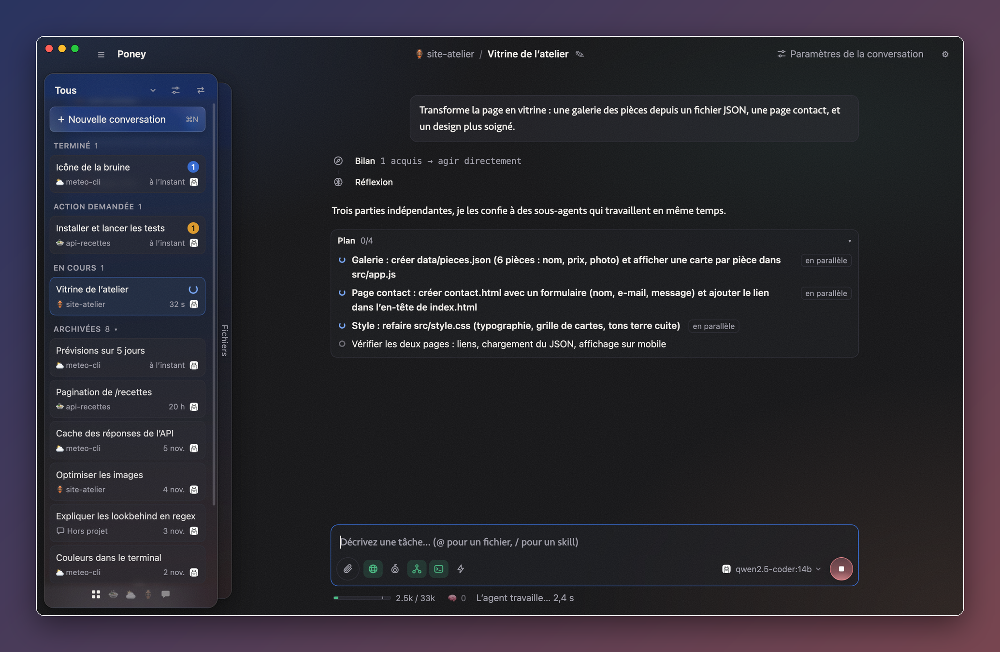

# Poney

A desktop coding agent (in the spirit of Claude Code / Codex) built for **small local models**: Ollama, LM Studio,
llama.cpp server, vLLM, or Poney's own engine. The interface is in French.



- [Getting started](#getting-started)
- [Models](#models)
- [Using the app](#using-the-app)
- [The harness: what is done for small models](#the-harness-what-is-done-for-small-models)
- [Command line](#command-line)
- [Development](#development)
- [Releases](#releases)
- [Platforms, Bun and Tor](#platforms-bun-and-tor)

## Getting started

Node 24 or later, and a model: a server (Ollama, LM Studio, llama.cpp server, vLLM, anything OpenAI compatible), a GGUF
file for Poney's engine, or a Claude or Antigravity login on the machine.

```bash
npm install
npm start                                                    # build to dist/ and run the app
node src/cli.ts --cwd ./my-project --model qwen2.5:14b "task"  # headless
```

Settings, conversations and logs live in `~/Library/Application Support/poney/` (`PONEY_DATA` points elsewhere).

## Models

**Providers** (Réglages › Fournisseurs): where models come from. Each one has a switch, and each of its models too: a
model switched off leaves the model menu, except for the conversation using it. Servers are added and removed freely.
The model menu shows Poney's models, then each server's (LM Studio's with its logo), then Claude's and Antigravity's;
the gear on a section's title opens that provider's card. A conversation keeps its provider and model; if the provider
is off or gone, the conversation stays readable and sending asks for another model.

**Poney's engine** runs GGUF models without any other app. `llama-server` (a pinned llama.cpp build, downloaded on
first use and checked against its digest) runs as a separate process on 127.0.0.1, one per model. Models come from
`<data>/models` (a button in the provider's settings opens it) and, read only, `~/.lmstudio/models`; a file both can
run shows under Poney only, and a file added to these folders shows at once. A message loads its model; an idle one
goes after 15 minutes. The context is set per model (a change reloads at the next message), and the prompt cache
survives unloading, on disk, up to 10 GB, the unused going first.

**One queue for local calls**: conversations and sub-agents alike go through "Inférences en même temps" (1 by default,
0 for no limit). Calls for the loaded model go first, past an older one at most 3 times. Memory comes before the
limit: idle models go, then calls wait. Claude's and Antigravity's models are not counted.

**Claude models**: when `claude` is installed and logged in, its models appear in the model menu. Poney then only
displays the work of the Claude harness (through the Agent SDK): its own harness is off, apart from the skills, and
the tool switches give way to the effort and the mode (Auto, Manuel, Plan). When Claude ends its turn to wait for a
background task, its conversation moves to **En veille** until the task brings it back. Beside the context gauge, the
session gauge shows how much of the 5-hour session is used; its tooltip gives the date of the next reset. Réglages ›
Fournisseurs shows each account's session and week. **This uses the machine's own Claude login, for personal use:
Anthropic does not allow third-party products to offer that login without its approval, so a public release must use
an API key or get that approval.**

**Antigravity models**: when Google's `agy` is installed and logged in, its models come last in the model menu. As
with Claude, Poney only displays the work of that harness: each message runs `agy -p … --output-format stream-json`
in the project, resumed with `--conversation`. The stream carries neither reasoning nor sub-agents, so Poney also
reads agy's logs (`~/.gemini/antigravity-cli/brain/<conversation>/.system_generated/`) while it runs. The context
gauge gives the tokens the last call used, the session gauge the quota left of the model's group (read by
`agy -p /usage`, no model runs). Headless, agy cannot ask for a permission: **Auto** approves everything, **Manuel**
keeps agy's own rules, **Plan** plans first. `PONEY_AGY` and `PONEY_AGY_BRAIN` name another `agy` and logs folder,
to try it without an account. Same note as Claude: the machine's own Google login, for personal use
(`src/agent/antigravity.ts`).

**Prompt reading progress** (LM Studio): percentage and time left before the first token. LM Studio is detected behind
"OpenAI compatible": the prompt is read through its SDK, which reports progress, then the answer is generated over
HTTP reusing that cache (the SDK cuts generations after ~5 min). Other servers do not expose this.

## Using the app

### Conversations

- **Sidebar by state**: *Brouillons* (typed, not sent), *Erreur* (a turn ended by an error: red outline, and a red
  pill counting the messages to read), *Terminé* (answers not read yet), *En veille* (waiting for a background task),
  *Action demandée* (an approval or a question waiting), *En cours* and *Archivées* (foldable). Each card has its
  title, project and date, and a pill for what waits (orange for approvals, blue for answers to read). ⇧⌘S folds the
  sidebars.
- **Several at once**: switching conversation does not stop the one shown; it goes on in the background and comes
  back as it is now, at the same reading position. Idle ones stay in memory (8 at most). Generations at the same time
  share the GPU.
- **Drafts**: a conversation becomes a draft at the first key typed; a new one takes its title from the text as it is
  typed. The text is kept when you leave or quit, and hovering a draft's card shows it in a tooltip.
- **Saved and renamable** (✎ or double-click), saved during a turn too: a crash only loses a few seconds, and an
  interrupted turn is flagged on reopening. A crashed window reloads by itself; errors go to `logs/main.log`.
  Right click on a card: mark as read, rename, delete.
- **Edit a previous message and relaunch** ("✎ Modifier" on hover): the agent goes back to its state before that
  message, even across a compaction, and what follows is removed. Files already modified are not restored. Without
  the exact state (old conversations, a crash), the history is rebuilt from the transcript. With Claude, the session
  is forked at its last entry before that message; agy cannot fork, so a new conversation starts, told the earlier
  exchanges (`recapOf` in `src/agent/rebuild.ts`).
- **Resume from here** (on hover over an action): back to just after the message that asked for it, the action runs
  again with the rest of its batch, and the agent goes on. A turn ended by an error offers "Reprendre".
- **Quote a passage**: select text, "❝ Citer" adds it to the input as a quote (formulas as their LaTeX source).
- **Notifications** when a conversation finishes, fails or asks for something: from the system when Poney is not in
  front, a tooltip in the window when the conversation is in the background.

### Projects and files

- **Projects**: the picker at the top of the sidebar lists one project's conversations, all of them ("Tous") or those
  outside projects. A two-finger horizontal swipe goes to the next project, dots at the bottom show where you are,
  ⌘1 to ⌘9 jump to one. A project can have an emoji, a colored icon or a picture. "Paramètres des projets" (⇧⌘P) puts
  them in order by dragging, renames them (the folder stays), hides them (nothing removed) or removes them from the
  app (the folder stays).
- **Right click on the sidebar**, a dot or a card: new conversation (⌘N or ⌘T), mark as read (⇧⌘U), project settings,
  add a project (⇧⌘O). The shortcuts act on the project listed (Ctrl outside macOS).
- **New conversation**: the input in the upper part of the window and a picker for its project (by default the one
  listed, else that of the last conversation looked at, else outside projects).



- **Outside any project** ("Hors projet"): same tools, in a folder of the conversation's own
  (`<data>/off-project/<id>/`), deleted with it.
- **A private folder per conversation**, `.poney/` for the model (in `<data>/scratch/<id>/`, outside the project and
  Git; `$PONEY_TMP` for commands), for its notes and scratch files.
- **File browser**, stacked with the conversations like a deck of two cards (the button at the top right of the card,
  its edge behind, a two-finger swipe, or ⇧⌘E). It updates when the agent writes, and colors names by their Git state.
  Files dragged from the Finder move into the project or the folder dropped on; files of the tree move by dragging.
  Right click: a new file, a new folder, the folder in the Finder.
- **Viewer**: syntax highlighting, images, Markdown formatted (with a "Code" button for the source); paths in the
  agent's actions are clickable. Text files can be edited there and saved.
- **Git**, the second section of the files card (⇧⌘G, ⇧⌘F back to the files): "Synchroniser" (fast-forward only; a
  branch without upstream is published; without a remote, the button sets one, an existing repository or a new one on
  GitHub), staged files, changes, recent commits, a diff per file. The remote is fetched at most every 5 minutes while
  shown, through Tor when commands are.
- **Remote tokens** (Réglages › Dépôts distants), one per address, encrypted by the system, given to Git through a
  credential helper. **Add from a remote repository** clones into a new project.

### The input

- **Attach files**: the paperclip, `@` (the project's files complete as you type; `@path` stays in the text), a drop
  from the Finder or the files panel, or a paste (images, and texts over 4,000 characters or 80 lines). Images show
  as thumbnails. A file from outside the project is copied into the private folder.
- **Skills**: instructions added to a message only when it needs them. Attach one with the paperclip or `/`, or let
  Poney add one when the message contains a trigger phrase (it says so; can be turned off). Eleven come with the app
  (`src/skills/`): one for syntheses, the others adapted for small models from
  [Matt Pocock](https://github.com/mattpocock/skills), [Anthropic](https://github.com/anthropics/skills) and
  [Cursor](https://github.com/cursor/plugins). Add your own in `.poney/skills/<name>.md` for a project, or in the
  data folder under `skills/`; `/skill-creator` writes one with you.
- **Tool switches**, as icons: Web, Tor, Sous-agents, Terminal, sans confirmation. A tool turned off leaves the system
  prompt and is refused if the model uses it anyway (`--no-web`, `--no-shell` in the CLI).
- **Context gauge** under the input (the tick marks the compaction threshold); a click compacts. The 🧠 button shows
  the conversation's memory, where notes can be added or removed.

### While the agent works

- **Steps as a stepper**: reasoning, assessments, compactions and tool calls are rows of one design, an icon then a
  title, linked from icon to icon. The icon shimmers while the step runs, turns yellow while it waits for you, red
  when it failed. A click opens what it read and wrote. The app's own warnings (an assessment it could not read, an
  answer refused) are rows too, under the step they are about. Streamed text, new steps and the sent message fade in.
- **Scrolling**: the view follows the answer until you scroll up once.
- **Command approval** (unless "sans confirmation"): Exécuter, Toujours autoriser or Refuser, with an optional reason
  passed on to the model.



- **Questions** (`<ask>`): the model can ask a few questions, each with proposed answers and room for your own words;
  the conversation waits under *Action demandée* like an approval.
- **Plans and sub-agents**: for a request with several steps, the model writes a plan and each task goes to a
  sub-agent, in order, `@parallel` tasks at the same time. A sub-agent's card stays compact; a click opens its whole
  work in a panel on the right.



- **Markdown answers**: GitHub Markdown, tables, code, LaTeX by KaTeX (`$…$`, `$$…$$`, `\(…\)`, `\[…\]`); raw HTML
  shows as text. Images the agent shows (``) appear in the answer, can be saved or dragged into the project.
- **Time and speed** under the final answer: total time, tokens, tokens/s (server counts, or estimates marked "≈").

### Settings

- **Apparence**: theme (system, light, dark); the conversations' typeface (Seravek, or the system's, heavier);
  **Contraste élevé**, for both themes (opaque panes, no grain or glow, stronger secondary text and borders);
  notifications.
- **Per conversation** ("Paramètres de la conversation"): the system prompt, generated and editable (a "modifié" badge
  marks a custom one); a step to do before each message and one before finishing (optionally only when files
  changed); the assessment, on or off.

## The harness: what is done for small models

### Prompt and tools

- **Short system prompt** (under 2,000 tokens) with a few examples, instead of several thousand: answer first and
  briefly, read irony as such, ask one question when the request is unclear, search the web for what may have changed.
  Every token of it is paid at each message, so what the app can do is not in it.
- **Date and time on each message** (`[Thu 2026-10-22 14:05] …`), not in the system prompt, so the server cache is
  never lost.
- **The model's own temperature** by default; a forced low one made answers flat and loops likelier.
- **Tools as text tags**, not JSON: `<write path="a.py">…</write>`, `<run>…</run>`. Code needs no escaping. The parser
  is lenient: aliases (`bash`, `read_file`…), arguments as attributes or child tags, optional quotes, fences removed.
  Native calls are understood too (Gemma `<|tool_call>`, Hermes/Qwen `<tool_call>`, `tool_calls` fields) and declared
  natively to the LM Studio models that support it.
- **A few tools**: list, read, search, write, edit, run, web_search, fetch, plus plan, agent, ask, remember, forget and
  recall.
- **Project search like a web search** (`<search>keywords</search>`): files ranked by relevance (rare words weigh
  more, words in paths and definitions count more, tests after the code), each with its best lines, so the agent reads
  only those. Identifiers are split the code way (`loadConfig` → load, config), roots match, `.gitignore` is respected.
  `pattern="regex"` lists every matching line. About 1 s for 3,000 files.
- **Raw mode for Gemma in LM Studio**: the prompt is formatted with the model's template and generated through
  `/v1/completions`, which returns every token (the chat endpoint held back everything after a tool call started).
- **Project notes** read from `AGENTS.md` / `PONEY.md` / `CLAUDE.md`; the agent adds there, one short line at a time,
  what it will need again (created if missing).

### Safeguards on edits

- **Lenient editing**: a wrongly indented `<old>` is re-indented; on failure the agent gets the closest lines.
- **`<old>` checked while it is written**: not found or ambiguous, the generation stops there and the model gets the
  error at once, instead of writing its whole `<new>` first.
- **Syntax check** after every write (.py, .js, .json).
- **No rewrites from memory**: `<write>` on an existing file is refused unless its content is in view; a large shrink
  triggers a warning.
- **Test gate**: the agent cannot finish while code it modified has not run successfully (the configured test command
  if any). Documentation and data files do not count.
- **Follow a write live**: a card opens a panel with the file growing; for an edit, the block replaced struck out and
  the new text under it.

### Assessment before acting

On by default, per conversation. Before the model may use its tools, one call on the cached prompt (JSON only when the
server supports it) asks it to list the facts its answer will rely on, graded known, doubt or unknown. The app, not the
model, picks the route: nothing lacking, act; a doubt, check it with one lookup; something unknown, read at least two
sources first. A web search does not count as a source, only pages read. A final answer given too early is refused
(once for a doubt, twice for an unknown), and what is left to check is recalled with each result. Pages, commands
with real output and searches update the assessment, at most 3 times a turn. A reply that cannot be read is asked
again up to 3 times; failing still means "check". Sub-agents assess their own task.

### Context and memory

- **Compaction as late as possible**, when the next call would no longer fit (~80-84 % of a 16k window): old messages
  are replaced by a summary (Context / Discussion / Work done / Open, ~4 % of the window, written as a continuation of
  the cached conversation) and facts extracted mechanically. Rare compactions keep the start of the prompt stable, so
  the server cache stays usable. The replaced history is archived; a fallback summary is built if the model fails.
- **Calibrated estimates**: token counts are calibrated on the server's real ones, and the context size actually loaded
  by the server caps the setting. The answer size adapts to the room left; an answer cut short never runs an
  unfinished action.
- **What to keep, before a compaction**: one constrained call asks what must not be lost (3 items at most). The app
  writes it to the conversation's memory or to the project's notes; a doc to update is left to a sub-agent that starts
  with an empty window.
- **Memory per conversation** (`<remember>`, `<forget>`): up to 20 short notes, copied into summaries and brought back
  when they drift out of view. Lasting instructions in your messages ("tutoie-moi", "from now on…") are noted by the
  app itself.
- **Recall**: `<recall>keywords</recall>` searches the archived part; with each message, the app also attaches up to
  2 earlier passages that share its rarest words. A chapter index in the summary says what is out of view.
- **Context hints, only when they help**: files changed in the project since the last answer, the file open in the
  viewer, the closest paths when one does not exist, the lines a failed command points at. A read repeated while its
  result is in view is not run again.
- **Reasoning kept as a short note**: the end of the model's reasoning (~600 characters) comes back in a `<reasoning>`
  block, so it does not start over after each tool result.
- **Links read automatically**: up to 2 public pages linked in a message are read before the model answers (15 s, the
  start of each page, marked as not being instructions). Can be turned off.

### Generation guards

- **Early stop** as soon as an action needs a result: no invented results.
- **Loops**: a passage repeated three times, or Gemma reopening its reasoning channel a third time, stops the
  generation. Without an action, the model is told to act instead of restating its plan.
- **A call at the end of the reasoning, then silence** for 10 s: the call runs.
- **Invisible output**: 45 s of generation with nothing visible, and the app retries without the reasoning notes.
- **Stream cut by the server**: what was written is kept and complete actions run.

### Sub-agents and plans

- **Sub-agents** (`<agent title="…">task</agent>`, or a list in one native call) work in their own copy of the
  project (dependencies linked), merged back by the app three ways, file by file (`src/agent/isolate.ts`). Conflicts,
  deletions and large cuts are held for the main agent, with the sub-agent's version in `.poney/agents/<id>/`. No
  sub-sub-agents. They run at the same time when "Inférences en même temps" allows it; at 1, one at a time, and the
  prompt stops offering parallel runs.
- **Plans** (`<plan>`): the model only writes the tasks; each goes to a sub-agent, which gets the request, the turn
  so far (steps that concern its task kept longer, cut ones readable with `<read path="@turn/N" />`), the plan, the
  reports and changes of earlier tasks. A failed task stops the plan; the model may write a new one for what is left.
  Without sub-agents, the plan is a list the model follows itself.

## Command line

`src/cli.ts` runs the harness without the app (`node src/cli.ts --help` lists everything). It can also let another
program use the engine, without touching the app's data:

```bash
node src/cli.ts engine-serve --model ID --num-ctx 16384 --cache-dir DIR --engine-dir DIR   # prints {baseUrl, apiKey, pid, numCtx, memory, build}
node src/cli.ts --provider poney --engine-url URL --engine-key-file FILE --json --yes "task"
node src/cli.ts models --json --models-dir DIR
node src/cli.ts version --json     # {commit, dirty, engineBuild, systemPromptHash}
```

- **`engine-serve`** keeps a model loaded until SIGTERM. `--engine-dir` is an installed engine, read only;
  `--max-inferences` sets its slots. Do not point `--engine-dir` at the app's own folder while the app may start.
- **`--provider poney`** goes through the same calls as the app. The key is read from a file and stays out of the
  environment, which commands inherit.
- **`--settings FILE`** applies `config` and `modelContexts` as the app does, read only; explicit options win.
- **`--script FILE.json`** sends a list of messages in one conversation, stopping at the first turn that does not
  finish.
- **`--json`** writes every event as one line, sub-agents included. `assistant_end` gains `rawText` (the output before
  parsing) and `action_start` gains `calledAs` (the name as written, or `gemma:`, `hermes:`, `tool_calls:`).
- **Exit codes**: 0 finished, 2 `--max-steps` reached, 3 model or server error, 130 stopped, 1 wrong usage. Without a
  terminal and without `--yes`, commands are refused.

## Development

Strict TypeScript, ES modules, no bundler: `tsc` builds `src/` to `dist/`, which Electron runs. Node runs the `.ts`
files directly for the tests, the CLI and the scripts (erasable syntax only). `any` is forbidden in every form; data
from outside is `unknown`, narrowed with `src/unknown.ts`. `AGENTS.md` has the rules.

```bash
npm run build        # dist/
npm run typecheck    # src/, test/ and scripts/
npm run lint         # fails on any `any`
npm test             # all the tests, with fake model servers: no model needed
```

Never try the app on real data: start a separate instance with its own data folder, and a debugging port to drive it:

```bash
npm run build && PONEY_DATA=/tmp/poney-test npx electron . --remote-debugging-port=9335
```

Layout:

- `src/agent/`: the harness, without UI. `protocol.ts` (system prompt, tool tags), `agent.ts` (the loop), `context.ts`
  (compaction), `triage.ts` (assessment), `tools.ts`, `llm.ts`, `isolate.ts` (sub-agents' copies), `claude.ts` and
  `antigravity.ts` (the other harnesses), `web.ts`, `tor.ts`.
- `src/main.ts`, `src/preload.cts`, `src/ipc.ts` (the IPC calls, typed), `src/renderer/`: the Electron app.
- `src/conversations.ts`, `src/files.ts`, `src/git.ts`, `src/providers.ts`: storage, files for the viewer, Git,
  providers.
- `src/engine/`: Poney's engine: `install.ts` (the pinned llama-server), `models.ts` and `gguf.ts`, `gate.ts` (the
  queue), `engine.ts` (processes, memory, prompt cache).
- `src/skills/`: the built-in skills. `src/cli.ts`: the command line.
- `scripts/`: `build.ts`, `brand-electron.ts` (macOS: names the development bundle `Poney.app`, with its icon),
  `compare-engine.ts` (the engine against LM Studio), `after-pack.ts` (packaging).
- `docs/instances.md`: where Poney instances talking to each other would fit. `assets/`: the icon.

## Releases

Pushing a tag builds the app and publishes it as a GitHub Release (`.github/workflows/release.yml`):

```bash
git tag v0.2.0
git push origin v0.2.0
```

The tag (`v` + semver) becomes the app's version; one with a `-` (`v0.2.0-beta.1`) makes a prerelease. The workflow
builds macOS arm64 and x64 (`.dmg`, `.zip`), Windows x64 (NSIS `.exe`) and Linux x64 (`.AppImage`); if one fails,
nothing is published. Locally, `npm run dist` packages for the current system into `release/`, and
`npx electron-builder --mac --dir` gives just the `.app`. The configuration is the `build` field of `package.json`.

Not in a release:

- **The engine**: llama-server is fetched on first use and checked against its pinned digest
  (`src/engine/install.ts`), for macOS arm64 only so far. Elsewhere, servers still work.
- **Claude**: the Agent SDK's own binary (about 250 MB) is left out; the `claude` installed on the machine is used,
  with its own login, for personal use only.

**Signing.** Without secrets, builds are unsigned (ad hoc on macOS, `scripts/after-pack.ts`, since Apple Silicon
refuses a mismatched signature). Gatekeeper then blocks a downloaded build: allow it in System Settings › Privacy &
Security, or run `xattr -dr com.apple.quarantine /Applications/Poney.app`. SmartScreen warns on Windows. Signing turns
on with these repository secrets:

| Secret | For |
|---|---|
| `MAC_CSC_LINK`, `MAC_CSC_KEY_PASSWORD` | Developer ID Application certificate (`.p12`, base64) and its password |
| `APPLE_ID`, `APPLE_APP_SPECIFIC_PASSWORD`, `APPLE_TEAM_ID` | notarization, with the macOS certificate |
| `WIN_CSC_LINK`, `WIN_CSC_KEY_PASSWORD` | Windows code-signing certificate (`.pfx`, base64) and its password |

## Platforms, Bun and Tor

**Platforms.** Developed and tested on macOS. Windows is supported in the code but not tested on a real machine yet:
commands run in `cmd.exe` (the model is told so), a stopped command kills its process tree, CRLF files keep their line
endings, and the Python syntax check uses `py -3` or `python`. Linux should work like macOS.

**Bun.** `bun install`, `bun start` and `bun run test` work (the tests run with Node, and the app always runs in
Electron). `bun test` only partly emulates `node:test`. `bun src/cli.ts` works, but refuses Tor: Bun's `node:http`
ignores the SOCKS agent, so requests would go out in the clear.

**Tor** (optional, off by default): web search and fetching through Tor's SOCKS proxy (`tor` on 9050 or Tor Browser on
9150, detected), names resolved by Tor, search through DuckDuckGo's .onion service. If Tor cannot be reached, requests
are refused, never sent in the clear. Commands can get the proxy variables too (curl, git, wget…, not a guarantee). A
dot beside the switch shows the state, through Tor's control port when enabled; a button tests the exit IP. CLI:
`--tor`.

If `tor` stays stuck at 10 % ("Connecting to a relay"), the network blocks relays and you need bridges. With Tor
Browser installed, its transports can be reused:

```bash
brew install tor
mkdir -p /opt/homebrew/etc/tor/pt
ln -sf "/Applications/Tor Browser.app/Contents/MacOS/Tor/PluggableTransports/lyrebird" /opt/homebrew/etc/tor/pt/lyrebird
```

Then, in `/opt/homebrew/etc/tor/torrc`: `ControlPort 127.0.0.1:9051` and `CookieAuthentication 1` (for the status in
the app), `UseBridges 1`, the `ClientTransportPlugin … exec /opt/homebrew/etc/tor/pt/lyrebird` lines and the
`Bridge …` lines (snowflake, obfs4) from Tor Browser (`chrome/toolkit/content/global/pt_config.json` inside
`Contents/Resources/omni.ja`), then `brew services restart tor`.
